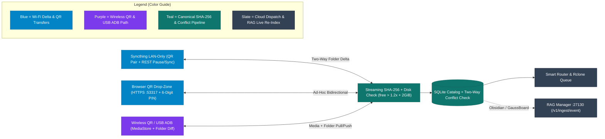
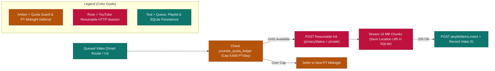

# System Architecture (`ARCHITECTURE.md`)
> **1-Line Summary:** Plain-English architectural blueprint of Cloud Manager (`[PLANNED]`, locked Go + TypeScript stack), security boundaries, subsystem data flows, and CI pipeline.

## 1. High-Level Visual System Map

```mermaid
flowchart TB
    classDef uiNode fill:#1d4ed8,stroke:#1e3a8a,color:#ffffff
    classDef coreNode fill:#0f766e,stroke:#115e59,color:#ffffff
    classDef secNode fill:#b45309,stroke:#78350f,color:#ffffff
    classDef adapterNode fill:#6d28d9,stroke:#4c1d95,color:#ffffff
    classDef targetNode fill:#334155,stroke:#0f172a,color:#ffffff

    subgraph UI["TypeScript Browser UI + Go System Tray (Material 3 Tonal)"]
        EXP["Virtual Explorer + Quick-Look + Density"]:::uiNode
        RULES_UI["Routing Editor + Dry-Run Bench"]:::uiNode
        MEDIA_UI["Phone Sync (Syncthing / ADB / QR)"]:::uiNode
        YT_UI["YouTube Private Pipeline Monitor"]:::uiNode
    end

    subgraph Core["Go Core Daemon (cloud-managerd.exe + cloud-manager.exe --json)"]
        AUTH["Security Guard (Bearer, Origin 403, Host, Path Jail)"]:::secNode
        BACKPLANE["Loopback HTTP / MCP (127.0.0.1:59432)"]:::coreNode
        SQL[("SQLite WAL + FTS5 (user_version, cursors, jobs)")]:::coreNode
        RULE_ENG["Router, Quota Spillover, Scheduler & Dedup"]:::coreNode
        INGEST["Unified SHA-256 Ingestion + RAG Webhook"]:::coreNode
    end

    subgraph Adapters["Job-Object Supervised Adapters"]
        ST["Upstream Syncthing LAN-Only (REST API)"]:::adapterNode
        LAN_QR["Browser QR Drop-Zone (HTTPS TLS :53317, OFF default)"]:::secNode
        ADB["Wireless QR / USB ADB Worker (Argv-Only)"]:::adapterNode
        YT_CLIENT["Go YouTube SDK Uploader (~200 LOC + Ledger)"]:::adapterNode
        KOPIA["Kopia CLI Bridge (Block-Delta App Snapshots)"]:::adapterNode
        RCLONE["rclone rcd (127.0.0.1:0, 256-bit RC Auth, DPAPI)"]:::adapterNode
    end

    subgraph Targets["Devices, Pentagram Ecosystem & Cloud Targets"]
        PHONE["Android Phone (Syncthing-Fork / Wireless ADB / Browser)"]:::targetNode
        EXE_CLIENTS["Custom .EXE Apps & RAG Manager (:27130)"]:::targetNode
        YT_CLOUD["YouTube Channel (Private Playlists)"]:::targetNode
        GDRIVE["Google Drive Remotes (Changes.list + bisync)"]:::targetNode
        MEGA["Mega.nz Remotes (hasher + Append/Archive)"]:::targetNode
    end

    UI <-->|Bearer + <=5Hz SSE| AUTH
    EXE_CLIENTS <-->|HTTP POST :59432 + Bearer| AUTH
    AUTH --> BACKPLANE
    BACKPLANE <--> SQL
    BACKPLANE --> RULE_ENG
    BACKPLANE -->|Large App Folders| KOPIA
    KOPIA --> RCLONE

    PHONE <-->|LAN TCP/QUIC (QR Pair)| ST
    PHONE <-->|HTTPS TLS + PIN :53317| LAN_QR
    PHONE <-->|Wireless QR / USB ADB| ADB
    ST --> INGEST
    LAN_QR --> INGEST
    ADB --> INGEST
    INGEST --> SQL
    INGEST --> RULE_ENG
    INGEST -.->|Obsidian/GaussBoard POST :27130| EXE_CLIENTS

    RULE_ENG -->|Videos| YT_CLIENT
    RULE_ENG -->|Pooled Cloud Files| RCLONE
    YT_CLIENT -->|OAuth2 Resumable| YT_CLOUD
    RCLONE <-->|Google REST API| GDRIVE
    RCLONE <-->|hasher + Pool Crypto| MEGA

    subgraph Legend["Legend (Color Guide)"]
        L1["Blue = TypeScript Browser UI (Material 3)"]:::uiNode
        L2["Teal = Go Core Daemon, SQLite & Routing"]:::coreNode
        L3["Amber = Security Guards & Opt-In TLS Boundary"]:::secNode
        L4["Purple = Isolated OSS & Cloud Adapters"]:::adapterNode
        L5["Slate = Devices, Pentagram & Cloud Targets"]:::targetNode
    end
```

* **How It Connects (Plain English):** A single Go daemon (`cloud-managerd.exe`) serves the TypeScript Material 3 UI and authenticated `127.0.0.1:59432` backplane + `/mcp`. Phone transfers via unmodified upstream Syncthing (LAN-Only), Wireless/USB ADB, or the opt-in Browser QR Drop-Zone (`:53317`) converge into one SHA-256 ingestion pipeline that updates SQLite, triggers `RAG Manager :27130` for Obsidian/GaussBoard changes, and routes to Rclone, Kopia, or YouTube.

---

## 2. Locked Tech Stack & OSS Reuse

* **AI-Friendly Language Policy:** Custom code is strictly **Go** (daemon, adapters, CLI/MCP) and **TypeScript** (UI). Battle-tested reused binaries/libraries (`Rclone`, `Syncthing`, `Kopia`, `ADB`, `SQLite 3`) run as supervised external tools.

| Layer | Locked Implementation (`[PLANNED]`) | Plain-English Rationale |
| :--- | :--- | :--- |
| **Core Daemon & CLI** | **Go** (`cloud-managerd.exe` + `cloud-manager.exe --json` + Tray) | Static ~15 MB `.exe`, ~25 MB idle RAM, goroutines for TLS/chunked uploads, native Windows Job Objects. |
| **Frontend UI** | **TypeScript + Vite + `TanStack Virtual` + `Lucide`** | Local Browser UI (portable Electron `.exe` deferred post-v1), Material 3 Tonal Light/Dark/System, WCAG AA. |
| **Local Catalog & Queue** | **SQLite 3** (`WAL`, `busy_timeout = 5000`, `FTS5`, `user_version`) | Sub-5 ms offline search, durable job state machine, `remote_cursors`, `tombstones`, and quota ledger. |
| **Multi-Cloud Pool** | **Rclone Core** (`>= v1.66`, `rcd`, `union`, `hasher`) *(Go OSS)* | Google Drive two-way `bisync` (`Changes.list`) + Mega Append/Archive tiers (`hasher`, zero `ModTime` loops). |
| **Phone Two-Way Delta** | **Syncthing** (`MPL-2.0` LAN-Only REST API) + **Wireless/USB ADB** + **QR Drop-Zone** (`:53317`) | Solves multicast drops, supports click-to-sync two-way folder deltas (`Obsidian`, `GaussBoard`, `DCIM`, `PDFs`, `Music`). |
| **App State Snapshots** | **SQLite `VACUUM INTO`** + **Kopia CLI** (`Apache-2.0`) | Safe live DB snapshots plus FastCDC block-delta deduplication for large custom `.exe` app directories. |
| **Video Archive** | **Official Go YouTube Data API v3 SDK** (~200 LOC) | Enforces `private` visibility, saves resumable `Location` URIs, enforces `9,600 / 10,000` PT quota cap. |

---

## 3. Core Subsystems & Security Boundaries (`[PLANNED]`)

### [SUBSYSTEM: Security-Boundaries-And-Hardening] | Aliases: security boundaries, loopback auth, rclone encryption, job object, data integrity
> **1-Line Summary:** Enforces fail-closed loopback authentication, DPAPI secrets, TLS LAN isolation, argv-only subprocesses, and atomic SQLite/file integrity across every boundary.

* **Loopback Backplane (`127.0.0.1:59432`):** Binds strictly to `127.0.0.1` (fail closed); requires `Authorization: Bearer <token>` (or `X-Local-Token`) from `%USERPROFILE%\.local\share\ecosystem-secrets.json` (`tokens.cloudManager`); rejects any browser `Origin` header (`403`); validates `Host` (`127.0.0.1:59432` / `localhost:59432`); validates `?app=` (`^[a-z0-9][a-z0-9_-]{0,63}$`).
* **Path & Subprocess Isolation:** Invokes `rclone`, `syncthing`, `adb`, and `kopia` via Go `exec.Command` argv arrays (never shells). Canonicalizes incoming filenames and rejects `..`, drive prefixes, UNC paths, junctions/symlinks, null bytes, and NTFS reserved names (`CON`, `PRN`, `AUX`, `NUL`, `COM1`–`COM9`, `LPT1`–`LPT9`).
* **Daemon Supervision & Secrets:** Unlocks `rclone.conf` via Windows DPAPI + `RCLONE_CONFIG_PASS` env var (never CLI argv); spawns `rclone rcd` and `syncthing` on `127.0.0.1:0` with ephemeral 256-bit API auth; binds all child processes to a Windows **Job Object** (`JOB_OBJECT_LIMIT_KILL_ON_JOB_CLOSE`).
* **Log & Telemetry Redaction:** Strips `Authorization`, `X-Local-Token`, OAuth tokens, passwords, and `RCLONE_*` fields from JSONL logs and `<= 5 Hz` SSE streams.
* **Data Integrity & Backups:** Runs numbered `PRAGMA user_version` migrations with pre-migration `.bak` snapshots (last 5 kept); atomic config saves (`temp -> fsync -> rename`, UTF-8 no BOM); `VACUUM INTO` for live app SQLite DBs; `(sha256, parent_revision)` conflict files (`<name>.conflict-<host>-<utc>.<ext>`).

---

### [SUBSYSTEM: Unified-Phone-Ingestion-WiFi-And-ADB] | Aliases: wifi phone sync, syncthing lan, wireless adb, browser qr dropzone, rag webhook
> **1-Line Summary:** Unifies unmodified Syncthing LAN-Only, Wireless/USB ADB QR pairing, and an opt-in Browser QR Drop-Zone into one two-way SHA-256 pipeline with `RAG Manager` re-indexing.



* **How It Works (Plain English):** Syncthing (LAN-Only, Global Discovery/relays disabled) handles true two-way block-level folder deltas via QR pairing; Wireless/USB ADB inspects phone MediaStore (`images/media`, `video/media`, UTC seconds, `\r\r\n` trimmed) and user-selected folders; the Browser QR Drop-Zone provides zero-app two-way transfers over `:53317`. Changes in `Obsidian` or `GaussBoard` notify `RAG Manager :27130`.

---

### [SUBSYSTEM: YouTube-Resumable-Video-Pipeline] | Aliases: youtube uploader, private video sync, quota ledger, video chunker
> **1-Line Summary:** Custom ~200 LOC Go uploader streaming 16 MB chunks to private YouTube playlists with persisted session URIs and PT quota limits.



* **How It Works (Plain English):** Enforces `9,600` daily PT quota (1,650 units/video), stores resumable `Location` URIs in SQLite for crash recovery, and skips `videos.list` polling loops.

---

### [SUBSYSTEM: Localhost-App-Backplane] | Aliases: app sync api, custom exe persistence, port 59432, kopia bridge
> **1-Line Summary:** Authenticated `127.0.0.1:59432` HTTP + `/mcp` server accepting `VACUUM INTO` DB snapshots, Kopia app-folder deltas, and `--json` CLI invocations.

* **How It Works (Plain English):** Serves custom `.exe` apps and AI agents via `127.0.0.1:59432`, `/mcp`, `cloud-manager://` URI, and `%USERPROFILE%\.local\bin\cloud-manager.exe --json`. Single-file DBs use `VACUUM INTO`; large multi-file `.exe` app directories snapshot through Kopia before cloud dispatch.

---

### [SUBSYSTEM: Rclone-Pool-And-Catalog-Reconciliation] | Aliases: rclone hasher, gdrive changes, mega append, sqlite cursors
> **1-Line Summary:** Reconciles Google Drive `changes.list` tokens and Mega `hasher` tree diffs into SQLite tombstones with `509` backoff and Duplicate Inspector support.

* **How It Works (Plain English):** Tracks `remote_cursors` and `tombstones` in SQLite. Google Drive runs two-way `bisync`; Mega uses `hasher` append/archive tiers with `509` backoff and surfaces remote deletions in a user-reviewable queue while powering the Cross-Account Duplicate Inspector.

---

## 4. Verification & CI Pipeline (`[PLANNED]`)

### [FLOW: Automated-Verification-And-CI-Pipeline] | Aliases: ci workflow, security regression, test suite, portable build
> **1-Line Summary:** Defines GitHub Actions Go + TypeScript CI verification, security regression gates, and tag-triggered portable Windows `.exe` builds.

* **Pipeline Target:** `.github/workflows/ci.yml` (bootstrapped on Phase 1 start from `agent-templates/templates/ci.yml`).
* **Locked Commands:** `go vet ./...`, `go test -race ./...`, `npm run lint`, `npx tsc --noEmit`, `npm test`, and `GOOS=windows GOARCH=amd64 go build` (plus tag-triggered `vX.Y.Z` portable `CloudManager.exe` release).
* **Security & Contract Regressions:** Automated tests assert `401` missing auth, `403` `Origin`, mismatched `Host`, `..`/NTFS path rejection, secret redaction, `\r\r\n` ADB fixtures, `--json` exit codes `0/1/2/3`, and UTF-8 without BOM.

---

## 5. Extension Recipes (`[PLANNED]`)
1. **Add a Cloud Provider:** Register Rclone remote capabilities (`ModTime`, hash type, rate limits) in the Go Rclone adapter and UI quota meter.
2. **Add a Routing Predicate:** Extend the Go rule matcher, add dry-run simulator unit tests, and wire the TypeScript Rule Editor field.
