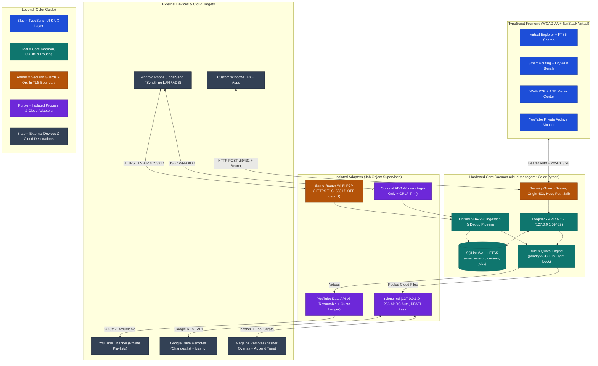
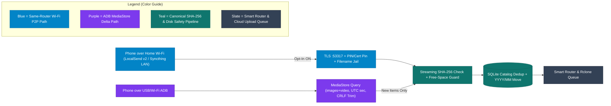
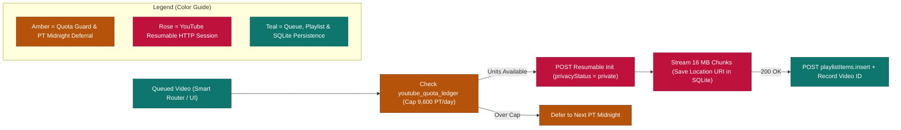

# System Architecture (`ARCHITECTURE.md`)
> **1-Line Summary:** Plain-English architectural blueprint of Cloud Manager (`[PLANNED]`), covering AI-friendly stack policy, security boundaries, subsystem data flows, and verification plans.

## 1. High-Level Visual System Map

* **How It Connects (Plain English):** All UI traffic and local `.exe` sync requests pass through the authenticated `127.0.0.1:59432` guard before touching SQLite or routing rules. Phone transfers over opt-in Wi-Fi P2P (`:53317`) or ADB merge into one SHA-256 deduplication pipeline, while `rclone rcd` and YouTube run as isolated worker adapters supervised by Windows Job Objects.

---

## 2. Tech Stack & AI-Friendly Language Policy

* **Custom-Written Code Policy:** Custom code is restricted strictly to **TypeScript/JavaScript, Go, or Python** so AI coding agents can maintain, refactor, and verify every layer cleanly. Reused open-source binaries and libraries may use any language.

| Layer | Planned Stack / OSS Reuse | Plain-English Rationale |
| :--- | :--- | :--- |
| **Core Daemon (`[PLANNED]`)** | **Go (`cloud-managerd.exe`)** or **Python 3.12+ (`uv`, FastAPI)** *(pending stack lock)* | Single-language clarity, strong HTTP/SQLite/process tooling, zero Rust borrow-checker friction. |
| **Frontend UI (`[PLANNED]`)** | **TypeScript + Vite + `TanStack Virtual` + `Lucide`** | 60 FPS virtual scrolling, strict typing, Light/Dark/System WCAG AA tokens, offline-safe bundles. |
| **Local Catalog & Queue** | **SQLite 3** (`WAL`, `busy_timeout = 5000`, `FTS5`, `user_version`) | Sub-5 ms offline search, durable job queue, remote change cursors, and rolling `.bak` safety. |
| **Multi-Cloud Transport** | **Rclone Core** (`>= v1.66`, `rcd`, `union`, `hasher`) *(Go OSS)* | Battle-tested Mega encryption, Google Drive `Changes.list`, and pool balancing. |
| **Phone Sync (Wi-Fi + ADB)** | **LocalSend v2 Protocol** (`:53317`) + optional **Syncthing LAN-Only** + **ADB** | Zero custom Android app code required; works over home Wi-Fi with USB ADB fallback. |
| **Video Archive** | **YouTube Data API v3** (official Go/Python SDK or `porjo/youtubeuploader`) | Enforces `privacyStatus = "private"`, playlist routing, and resumable chunk recovery. |

---

## 3. Core Subsystems & Security Boundaries (`[PLANNED]`)

### [SUBSYSTEM: Security-Boundaries-And-Hardening] | Aliases: security boundaries, loopback auth, rclone encryption, job object, data integrity
> **1-Line Summary:** Enforces fail-closed loopback authentication, encrypted secrets, TLS LAN isolation, argv-only subprocesses, and atomic SQLite/file integrity across every boundary.

* **Loopback Backplane (`127.0.0.1:59432`):** Binds strictly to `127.0.0.1` (fail closed if overridden); requires `Authorization: Bearer <token>` (or `X-Local-Token`) from `%USERPROFILE%\.local\share\ecosystem-secrets.json` (`tokens.cloudManager`); rejects any `Origin` header with `403 Forbidden`; enforces `Host` matching `^127\.0\.0\.1:59432$|^localhost:59432$`; validates `?app=` against `^[a-z0-9][a-z0-9_-]{0,63}$`.
* **Path & Subprocess Isolation:** Executes all external binaries (`rclone`, `adb`, `syncthing`) strictly via argv arrays (`shell=False` / `exec.Command` / `execFile`). Canonicalizes incoming filenames and rejects `..`, drive letters, UNC paths, symlinks/junctions, null bytes, and NTFS reserved names (`CON`, `PRN`, `AUX`, `NUL`, `COM1`–`COM9`, `LPT1`–`LPT9`).
* **Rclone & Secret Protection:** Encrypts `rclone.conf` using a master key protected by Windows DPAPI and injected via `RCLONE_CONFIG_PASS` environment variable (never CLI argv or plaintext disk); binds `rclone rcd` to `127.0.0.1:0` with ephemeral 256-bit `--rc-user`/`--rc-pass` and `--rc-allow-origin ""`; attaches child processes to a Windows **Job Object** (`JOB_OBJECT_LIMIT_KILL_ON_JOB_CLOSE`).
* **Log & Telemetry Redaction:** Passes all JSONL logs and UI SSE events (`<= 5 Hz`) through middleware stripping `Authorization`, `X-Local-Token`, OAuth tokens, passwords, and `RCLONE_*` fields.
* **Data Integrity & Backups:** Gates schema changes behind `PRAGMA user_version` migrations with pre-migration `.bak` copies (retaining last 5); writes config files atomically (`temp -> fsync -> rename`, UTF-8 without BOM); captures live `.exe` app SQLite DBs via `VACUUM INTO`; preserves conflicting edits via `(sha256, parent_revision)` as `<name>.conflict-<host>-<utc>.<ext>`.

---

### [SUBSYSTEM: Unified-Phone-Ingestion-WiFi-And-ADB] | Aliases: wifi phone sync, lan p2p, adb sync, mediastore compare, sha256 dedup
> **1-Line Summary:** Combines opt-in Same-Router Wi-Fi P2P (`:53317`) and ADB MediaStore queries into one streaming SHA-256 deduplication and filing pipeline.

* **How It Works (Plain English):** Both Wi-Fi transfers (`:53317` LocalSend v2 HTTPS/PIN or optional Syncthing LAN-only folder) and ADB pulls (`images/media` + `video/media` with UTC seconds normalization) pass free-disk pre-flight checks (`free > incoming * 1.2 + 2 GiB`) and streaming SHA-256 deduplication before routing to cloud storage.
* **Status:** `[PLANNED]` — `staging/` path configurable to secondary drives (`D:`/`E:`) with failed-artifact TTL cleanup.

---

### [SUBSYSTEM: YouTube-Resumable-Video-Pipeline] | Aliases: youtube uploader, private video sync, quota ledger, video chunker
> **1-Line Summary:** Streams 16 MB video chunks to private YouTube playlists with persistent resumable URIs and daily PT quota accounting.

* **How It Works (Plain English):** Checks `youtube_quota_ledger` (1,650 units per video + playlist insert) before opening a `private` resumable session, saves the `Location` URI in SQLite so crashes resume without re-burning 1,600 units, and skips polling `videos.list` loops.

---

### [SUBSYSTEM: Localhost-App-Backplane] | Aliases: app sync api, custom exe persistence, port 59432, vacuum into
> **1-Line Summary:** Authenticated `127.0.0.1:59432` HTTP + `/mcp` server accepting `VACUUM INTO` app snapshots and queueing cloud sync offline-first.

* **How It Works (Plain English):** Custom Windows `.exe` apps authenticate with Bearer tokens from `ecosystem-secrets.json`, export clean SQLite snapshots via `VACUUM INTO` (avoiding `-wal`/`-shm` tears), and post to `127.0.0.1:59432/api/v1/sync?app=<slug>`. State saves immediately to local storage/SQLite offline and syncs to Google Drive asynchronously with `Retry-After` / exponential backoff.

---

### [SUBSYSTEM: Rclone-Pool-And-Catalog-Reconciliation] | Aliases: rclone hasher, gdrive changes, mega append, sqlite cursors
> **1-Line Summary:** Reconciles out-of-band cloud changes using Google Drive `changes.list` tokens and Mega `hasher` recursive tree diffs into SQLite tombstones.

* **How It Works (Plain English):** Tracks `remote_cursors (remote_id, cursor_token, last_reconciled_at)` and `tombstones` in SQLite. Google Drive syncs via `changes.list` page tokens; Mega remotes run under Rclone `hasher` with append/archive semantics and `509` bandwidth backoff so missing native `ModTime` never causes re-upload loops.

---

## 4. Verification & CI Pipeline (`[PLANNED]`)

### [FLOW: Automated-Verification-And-CI-Pipeline] | Aliases: ci workflow, security regression, test suite, portable build
> **1-Line Summary:** Defines GitHub Actions CI checks, security regression gates, and tag-triggered portable `.exe` builds once the core stack is locked.

* **Pipeline Target:** `.github/workflows/ci.yml` (bootstrapped from `agent-templates/templates/ci.yml` after stack lock).
* **Required Gates:** Static lint/type checks (`tsc` + `go vet` or `ruff`/`mypy`), mocked adapter unit/integration suites (Rclone JSON-RPC, ADB `\r\r\n` fixtures, YouTube quota/resumable chunks, LocalSend LAN loopback), and security regression checks (`401` missing auth, `403` `Origin`, bad `Host`, path traversal, secret redaction).
* **Release Packaging:** Tag-triggered (`vX.Y.Z`) GitHub Actions release producing a Windows 10/11 x64 portable `.exe` (`CloudManager.exe`).

---

## 5. Extension Recipes (`[PLANNED]`)
1. **Add a Cloud Provider:** Add an Rclone remote capability descriptor (hash support, `ModTime` reliability, rate-limit policy) in the Rclone adapter config + UI quota meter component.
2. **Add a Routing Predicate:** Extend the priority-ordered rule matcher schema, dry-run simulator test suite, and Rule Editor form controls.
