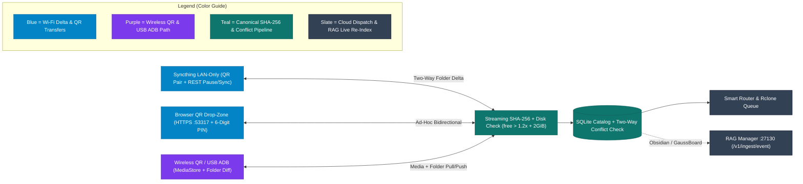
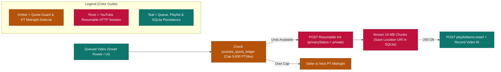

# System Architecture (`ARCHITECTURE.md`)
> **1-Line Summary:** Living architectural blueprint of Cloud Manager (`[IMPLEMENTED]` Go + TypeScript stack), security boundaries, subsystem data flows, and GitHub CI pipeline.

## 1. High-Level Visual System Map

```mermaid
flowchart TB
    classDef uiNode fill:#1d4ed8,stroke:#1e3a8a,color:#ffffff
    classDef coreNode fill:#0f766e,stroke:#115e59,color:#ffffff
    classDef secNode fill:#b45309,stroke:#78350f,color:#ffffff
    classDef adapterNode fill:#6d28d9,stroke:#4c1d95,color:#ffffff
    classDef targetNode fill:#334155,stroke:#0f172a,color:#ffffff

    subgraph UI["TypeScript Browser UI (web/) + Go System Tray (internal/tray)"]
        EXP["Virtual Explorer + Quick-Look + Density"]:::uiNode
        RULES_UI["Routing Editor + Dry-Run Bench"]:::uiNode
        MEDIA_UI["Phone Sync (Syncthing / ADB / QR)"]:::uiNode
        YT_UI["YouTube Private Pipeline Monitor"]:::uiNode
    end

    subgraph Core["Go Core Daemon (cmd/cloud-managerd + cmd/cloud-manager)"]
        AUTH["Security Guard (Bearer, Origin 403, Host, Path Jail)"]:::secNode
        BACKPLANE["Loopback HTTP / SSE / MCP (127.0.0.1:59432)"]:::coreNode
        SQL[("SQLite WAL + FTS5 (user_version, cursors, jobs)")]:::coreNode
        RULE_ENG["Router, Quota Spillover, Scheduler & Dedup"]:::coreNode
        INGEST["Unified SHA-256 Ingestion + RAG Webhook"]:::coreNode
    end

    subgraph Adapters["Job-Object Supervised Adapters (internal/adapters/)"]
        ST["Upstream Syncthing LAN-Only (REST API)"]:::adapterNode
        LAN_QR["Browser QR Drop-Zone (HTTPS TLS :53317, OFF default)"]:::secNode
        ADB["Wireless QR / USB ADB Worker (Argv-Only)"]:::adapterNode
        YT_CLIENT["Go YouTube SDK Uploader (16 MB Chunks + Ledger)"]:::adapterNode
        KOPIA["Kopia CLI Bridge (Block-Delta App Snapshots)"]:::adapterNode
        RCLONE["rclone rcd (127.0.0.1:0, 256-bit RC Auth, DPAPI)"]:::adapterNode
    end

    subgraph Targets["Devices, Pentagram Ecosystem & Cloud Targets"]
        PHONE["Android Phone (Syncthing-Fork / Wireless ADB / Browser)"]:::targetNode
        EXE_CLIENTS["Custom .EXE Apps & RAG Manager (:27130)"]:::targetNode
        YT_CLOUD["YouTube Channel (Private Playlists)"]:::targetNode
        GDRIVE["Google Drive Remotes (Changes.list + bisync)"]:::targetNode
        MEGA["Mega.nz Remotes (hasher + Append/Archive)"]:::targetNode
    end

    UI <-->|Bearer + <=5Hz SSE| AUTH
    EXE_CLIENTS <-->|HTTP POST :59432 + Bearer| AUTH
    AUTH --> BACKPLANE
    BACKPLANE <--> SQL
    BACKPLANE --> RULE_ENG
    BACKPLANE -->|Large App Folders| KOPIA
    KOPIA --> RCLONE

    PHONE <-->|LAN TCP/QUIC (QR Pair)| ST
    PHONE <-->|HTTPS TLS + PIN :53317| LAN_QR
    PHONE <-->|Wireless QR / USB ADB| ADB
    ST --> INGEST
    LAN_QR --> INGEST
    ADB --> INGEST
    INGEST --> SQL
    INGEST --> RULE_ENG
    INGEST -.->|Obsidian/GaussBoard POST :27130| EXE_CLIENTS

    RULE_ENG -->|Videos| YT_CLIENT
    RULE_ENG -->|Pooled Cloud Files| RCLONE
    YT_CLIENT -->|OAuth2 Resumable| YT_CLOUD
    RCLONE <-->|Google REST API| GDRIVE
    RCLONE <-->|hasher + Pool Crypto| MEGA

    subgraph Legend["Legend (Color Guide)"]
        L1["Blue = TypeScript Browser UI (Material 3)"]:::uiNode
        L2["Teal = Go Core Daemon, SQLite & Routing"]:::coreNode
        L3["Amber = Security Guards & Opt-In TLS Boundary"]:::secNode
        L4["Purple = Isolated OSS & Cloud Adapters"]:::adapterNode
        L5["Slate = Devices, Pentagram & Cloud Targets"]:::targetNode
    end
```

* **How It Connects (Plain English):** A single Go daemon (`internal/server/server.go` -> `Daemon`) serves the embedded TypeScript Material 3 UI (`web/`, built into `internal/webui/dist`) and authenticated `127.0.0.1:59432` backplane + `/mcp`. Phone transfers via unmodified upstream Syncthing (LAN-Only), Wireless/USB ADB, or the opt-in Browser QR Drop-Zone (`:53317`) converge into one SHA-256 ingestion pipeline (`internal/ingest`) that updates SQLite (`internal/db`), triggers `RAG Manager :27130` for Obsidian/GaussBoard changes, and routes to Rclone, Kopia, or YouTube.

---

## 2. Implemented Tech Stack & OSS Reuse

* **AI-Friendly Language Policy:** Custom code is strictly **Go** (`cmd/`, `internal/`) and **TypeScript** (`web/`). Battle-tested reused binaries/libraries (`Rclone`, `Syncthing`, `Kopia`, `ADB`, `modernc.org/sqlite`) run safely without CGO bloat.

| Layer | Implementation (`[IMPLEMENTED]`) | Code Anchors |
| :--- | :--- | :--- |
| **Core Daemon & CLI** | **Go** (`cmd/cloud-managerd`, `cmd/cloud-manager`, `cmd/CloudManager`, `internal/tray`) | `internal/server/runner.go` -> `RunForegroundDaemon`, `internal/cli/cli.go` -> `Run` |
| **Frontend UI** | **TypeScript + Vite + `@tanstack/virtual-core` + `lucide`** | `web/src/main.ts` -> `bootstrapApp`, `web/src/views/explorer.ts` -> `renderExplorerView` |
| **Local Catalog & Queue** | **SQLite 3** (`modernc.org/sqlite` WAL, `busy_timeout = 5000`, `FTS5`, `user_version`) | `internal/db/db.go` -> `Open`, `Store.SearchCatalog`, `SnapshotSQLiteFile` |
| **Multi-Cloud Pool** | **Rclone Core** (`>= v1.66`, `rcd`, `union`, `hasher`) | `internal/adapters/rclone/rclone.go` -> `Supervisor.Start`, `Supervisor.TransferFile` |
| **Phone Two-Way Delta** | **Syncthing** (`MPL-2.0` LAN-Only REST API) + **ADB** + **QR Drop-Zone** (`:53317`) | `internal/adapters/syncthing/syncthing.go`, `internal/adapters/adb/adb.go`, `internal/adapters/lanqr/server.go` |
| **App State Snapshots** | **SQLite `VACUUM INTO`** + **Kopia CLI** (`Apache-2.0`) | `internal/server/server.go` -> `Daemon.handleAppBackplaneSync`, `internal/adapters/kopia/bridge.go` |
| **Video Archive** | **Official Go YouTube Data API v3 SDK** | `internal/adapters/youtube/uploader.go` -> `Uploader.ProcessJob` |

---

## 3. Core Subsystems & Security Boundaries (`[IMPLEMENTED]`)

### [SUBSYSTEM: Security-Boundaries-And-Hardening] | Aliases: security boundaries, loopback auth, rclone encryption, job object, data integrity
> **1-Line Summary:** Enforces fail-closed loopback authentication, DPAPI secrets, TLS LAN isolation, argv-only subprocesses, and atomic SQLite/file integrity across every boundary.

* **Loopback Backplane (`127.0.0.1:59432`):** `internal/security/security.go` -> `IsLoopbackBind`, `ValidateLoopbackHost`, `ValidateOrigin`, `ConstantTimeTokenMatch`, `ValidateAppSlug`; `internal/server/server.go` -> `Daemon.withGuard`.
* **Path & Subprocess Isolation:** `internal/security/security.go` -> `SanitizeRelPath`, `ResolveConfinedPath` (blocks `..`, drives, UNC, null bytes, NTFS reserved names, and symlink/junction escapes).
* **Daemon Supervision & DPAPI Secrets:** `internal/security/job_windows.go` -> `JobSupervisor` (`JOB_OBJECT_LIMIT_KILL_ON_JOB_CLOSE`); `internal/security/dpapi_windows.go` -> `ProtectSecret`, `UnprotectSecret`.
* **Log Redaction & Atomic Configs:** `internal/security/security.go` -> `RedactSecrets`, `RedactMap`; `internal/config/config.go` -> `WriteAtomicNoBOM`, `Logger`.

---

### [SUBSYSTEM: Unified-Phone-Ingestion-WiFi-And-ADB] | Aliases: wifi phone sync, syncthing lan, wireless adb, browser qr dropzone, rag webhook
> **1-Line Summary:** Unifies unmodified Syncthing LAN-Only, Wireless/USB ADB QR pairing, and an opt-in Browser QR Drop-Zone into one two-way SHA-256 pipeline with `RAG Manager` re-indexing.



* **Code Anchors:** `internal/ingest/pipeline.go` -> `Pipeline.Ingest`, `Pipeline.notifyRAGManager`; `internal/adapters/syncthing/syncthing.go` -> `Client`; `internal/adapters/adb/adb.go` -> `Client`; `internal/adapters/lanqr/server.go` -> `Server`.

---

### [SUBSYSTEM: YouTube-Resumable-Video-Pipeline] | Aliases: youtube uploader, private video sync, quota ledger, video chunker
> **1-Line Summary:** Custom Go uploader streaming 16 MB chunks to private YouTube playlists with persisted session URIs and PT quota limits.



* **Code Anchors:** `internal/adapters/youtube/uploader.go` -> `Uploader.ProcessJob`, `Uploader.QuotaStatus`; `internal/db/db.go` -> `Store.AddYouTubeQuota`.

---

### [SUBSYSTEM: Localhost-App-Backplane] | Aliases: app sync api, custom exe persistence, port 59432, kopia bridge
> **1-Line Summary:** Authenticated `127.0.0.1:59432` HTTP + `/mcp` server accepting `VACUUM INTO` DB snapshots, Kopia app-folder deltas, and `--json` CLI invocations.

* **Code Anchors:** `internal/server/server.go` -> `Daemon.handleAppBackplaneSync`, `Daemon.handleMCP`, `Daemon.handleShutdown`, `Daemon.handleAccounts`; `internal/server/runner.go` -> `ProbeRunningDaemon`, `RunDaemon`; `internal/telemetry/hub.go` -> `Hub.loop`; `internal/branding/logo.go` -> `PNG`, `ICO`; `internal/tray/tray_windows.go` -> `loadTrayIcons`; `internal/cli/cli.go` -> `runQuit`, `runUpgrade`, `runIcon`; `internal/db/db.go` -> `SnapshotSQLiteFile`, `Store.DeleteAccount`; `internal/adapters/kopia/bridge.go` -> `Bridge`.

---

### [SUBSYSTEM: Rclone-Pool-And-Catalog-Reconciliation] | Aliases: rclone hasher, gdrive changes, mega append, sqlite cursors
> **1-Line Summary:** Reconciles Google Drive changes and Mega `hasher` tree diffs into SQLite tombstones with `509` backoff and Duplicate Inspector support.

* **Code Anchors:** `internal/adapters/rclone/rclone.go` -> `Supervisor.RefreshQuota`, `Supervisor.ReconcileRemote`, `Supervisor.TransferFile`; `internal/db/db.go` -> `Store.SetRemoteCursor`, `Store.AddTombstone`.

---

## 4. Verification & CI Pipeline (`[IMPLEMENTED]`)

### [FLOW: Automated-Verification-And-CI-Pipeline] | Aliases: ci workflow, security regression, test suite, portable build, inno setup installer
> **1-Line Summary:** Runs GitHub Actions Go + TypeScript verification across Ubuntu and Windows runners, compiles the per-user Inno Setup installer (`CloudManager-Setup.exe`), and publishes tag-triggered releases.

* **Workflows:** `.github/workflows/ci.yml` (`verify-linux` + `verify-windows` building `-H=windowsgui` `CloudManager.exe`, generating `build/cloud-manager.ico` via `cloud-manager icon`, compiling `packaging/CloudManager.iss` via `ISCC.exe`, smoke-testing `upgrade --dry-run --json`, and generating `ci-failure-report` on failure) and `.github/workflows/release.yml` (`windows-latest` tag-triggered `vX.Y.Z` release of `CloudManager-Setup.exe`, portable binaries, and `SHA256SUMS.txt`).

---

## 5. Extension Recipes
1. **Add a Cloud Provider:** Extend `internal/adapters/rclone/rclone.go` (`ValidateSyncMode`, `TransferFile`) and add a provider filter chip in `web/src/views/explorer.ts` -> `renderExplorerView`.
2. **Add a Routing Predicate:** Extend `internal/routing/router.go` -> `matchesRule`, add unit tests in `internal/routing/router_test.go`, and wire the field in `web/src/views/rules.ts` -> `renderRulesView`.
