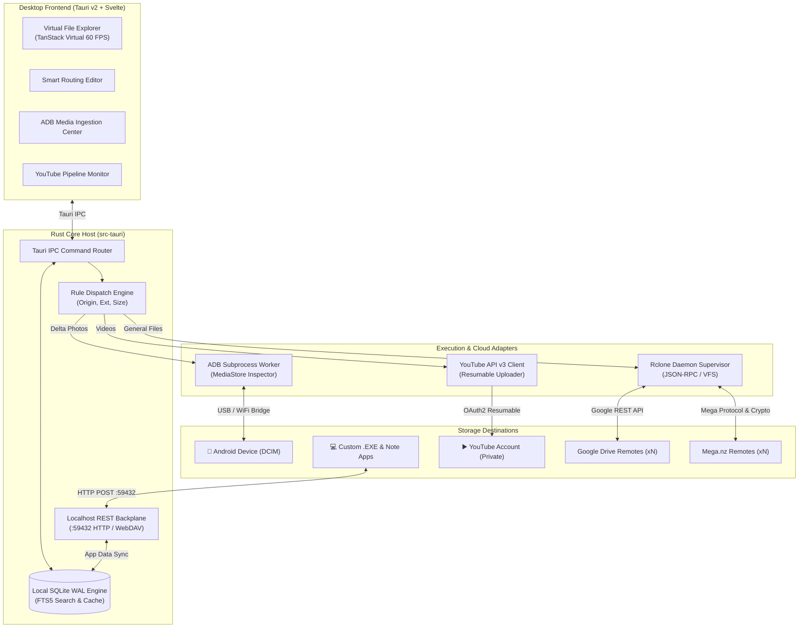
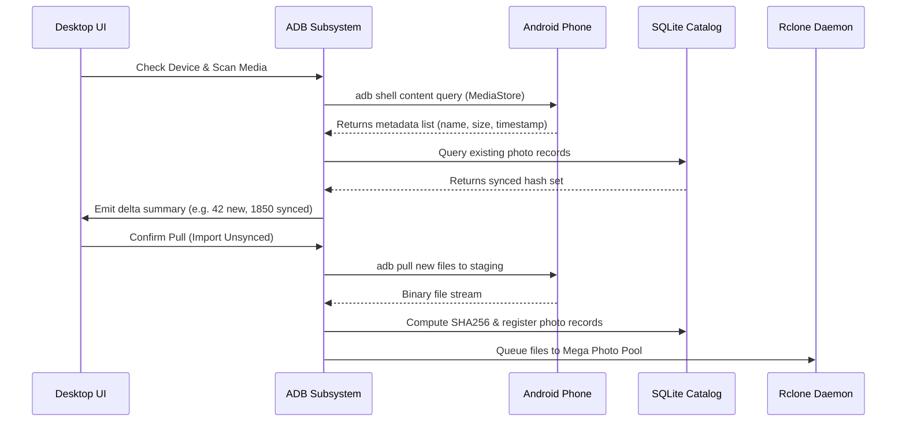
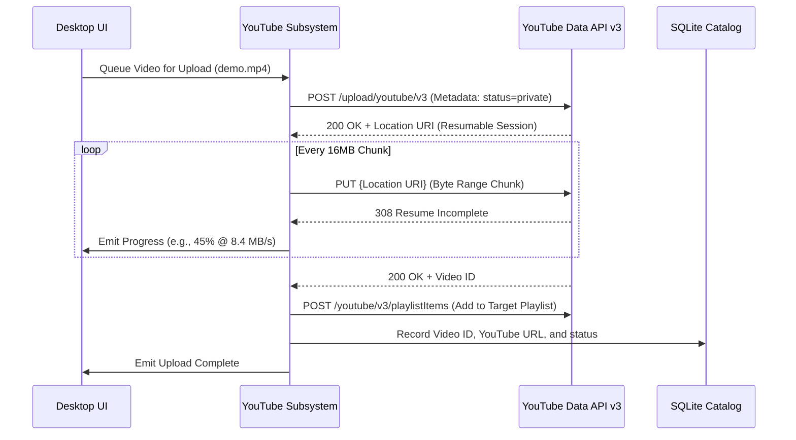

# System Architecture (`ARCHITECTURE.md`)
> **1-Line Summary:** Plain-English architectural blueprint of the Cloud Manager system, subsystem mechanics, data flow sequence diagrams, and safe extension recipes.

## 1. High-Level Visual System Map

---

## 2. Tech Stack & Why We Chose It

| Layer | Tool / Library | Plain-English Reason Why |
| :--- | :--- | :--- |
| **Desktop Host** | Tauri v2 (Rust + WebView2) | Compiles to a single tiny portable `.exe` (<25 MB), uses minimal RAM (<40 MB vs 400 MB in Electron), and provides secure native OS access. |
| **Frontend Framework** | Svelte 5 + TypeScript + Tailwind CSS | Highly reactive, zero virtual-DOM overhead, and ideal for high-frequency progress bar updates without UI jank. |
| **Local Catalog & Cache** | SQLite 3 (WAL Mode + FTS5) | Guarantees instant sub-millisecond search across tens of thousands of files offline without making slow cloud API calls. |
| **Multi-Cloud Transport** | Rclone Core (Daemon Mode) | Handles the hardest network and cryptographic challenges (Mega.nz client-side decryption, Google Drive OAuth token refresh, bandwidth throttling). |
| **Mobile Sync Bridge** | Android Debug Bridge (ADB CLI) | Fast, reliable physical USB and local WiFi transfer protocol with direct access to Android MediaStore metadata. |
| **Video Ingestion** | Google YouTube Data API v3 | Uploads videos directly as playable media assets with strict privacy tags, bypassing cloud file storage limitations. |

---

## 3. Core Subsystems & Engineering Tricks

### [SUBSYSTEM: ADB-Incremental-Photo-Ingestion] | Aliases: adb sync, phone photo delta, mediastore compare
> **1-Line Summary:** Extracts metadata from the Android device via ADB, compares it against the local SQLite database, and downloads only new photos and videos.

* **How It Works (Plain English):** When the user triggers phone sync, the subsystem queries the Android device using `adb shell content query` against the system MediaStore table (`date_modified`, `_size`, `_display_name`). It compares these records against the local SQLite catalog. Any file whose size and modified timestamp already exist in SQLite is immediately marked `ALREADY_SYNCED` without transfer. For new files, it runs a chunked `adb pull` to a staging directory, calculates the SHA-256 hash, moves the file into date-organized folders (`/Photos/YYYY/MM/`), and queues it for cloud upload.
* **Data Flow Diagram:**

* **Code Anchors (Grep Targets):**
  * `src-tauri/src/adb/client.rs` -> `AdbDeviceManager::query_mediastore`
  * `src-tauri/src/adb/sync_worker.rs` -> `execute_incremental_pull`

---

### [SUBSYSTEM: YouTube-Resumable-Video-Pipeline] | Aliases: youtube uploader, private video sync, video chunker
> **1-Line Summary:** Uploads designated video files to a specific YouTube channel as private videos in designated playlists via HTTP resumable uploads.

* **How It Works (Plain English):** Video files (such as screen recordings, project demos, or family videos) exceed standard cloud drive quotas quickly. The YouTube pipeline initiates an HTTP POST to `https://www.googleapis.com/upload/youtube/v3/videos?uploadType=resumable` with a strict payload containing `snippet.playlistId` and `status.privacyStatus = "private"`. It transfers the video in 16 MB chunks, emitting upload progress percentage and speed metrics back to the Tauri frontend.
* **Data Flow Diagram:**

* **Code Anchors (Grep Targets):**
  * `src-tauri/src/youtube/uploader.rs` -> `YouTubeUploader::upload_resumable_video`
  * `src-tauri/src/youtube/token.rs` -> `OAuthTokenManager::refresh_token`

---

### [SUBSYSTEM: Localhost-App-Backplane] | Aliases: app sync api, custom exe persistence, port 59432
> **1-Line Summary:** A local HTTP server listening on port `59432` providing instant push/pull sync endpoints for custom `.exe` and note-taking apps.

* **How It Works (Plain English):** Custom Windows desktop applications and note-taking tools send simple HTTP POST requests with their state, JSON payloads, or SQLite database dumps to `http://127.0.0.1:59432/api/v1/sync?app=<app-name>`. The backplane saves the state locally, writes a revision log into the SQLite catalog, and instructs Rclone or the delta sync engine to upload the modified file to Google Drive.
* **Code Anchors (Grep Targets):**
  * `src-tauri/src/backplane/server.rs` -> `start_local_backplane`
  * `src-tauri/src/backplane/handlers.rs` -> `handle_sync_request`

---

## 4. Verification & Health Checks

### [VERIFY: Automated-Check-Suite] | Aliases: test commands, build check, audit
> **1-Line Summary:** Standard commands required to verify frontend types, Rust logic, and build health before committing.

* **Frontend Type & Lint Check:** `npm run check && npm run lint`
* **Rust Backend Compilation & Tests:** `cargo test --manifest-path src-tauri/Cargo.toml`
* **Tauri Desktop Build Check:** `npm run tauri build`

---

## 5. Recipes: How to Add New Things Safely

### To add a new cloud provider target (e.g., Dropbox or S3):
1. Open `src-tauri/src/rclone/account_manager.rs` -> add provider identifier to `SupportedProvider` enum.
2. In `src-tauri/src/rules/engine.rs` -> register the new provider type in `evaluate_target_account`.
3. In `src/lib/components/StorageMeter.svelte` -> add brand color and quota badge styles.

### To add a new smart routing trigger (e.g., File Tag or Subdirectory depth):
1. In `src-tauri/src/rules/engine.rs` -> add the condition to `RuleMatcher::matches_file`.
2. In `src/lib/components/RuleEditorModal.svelte` -> add UI form input for the new rule attribute.
