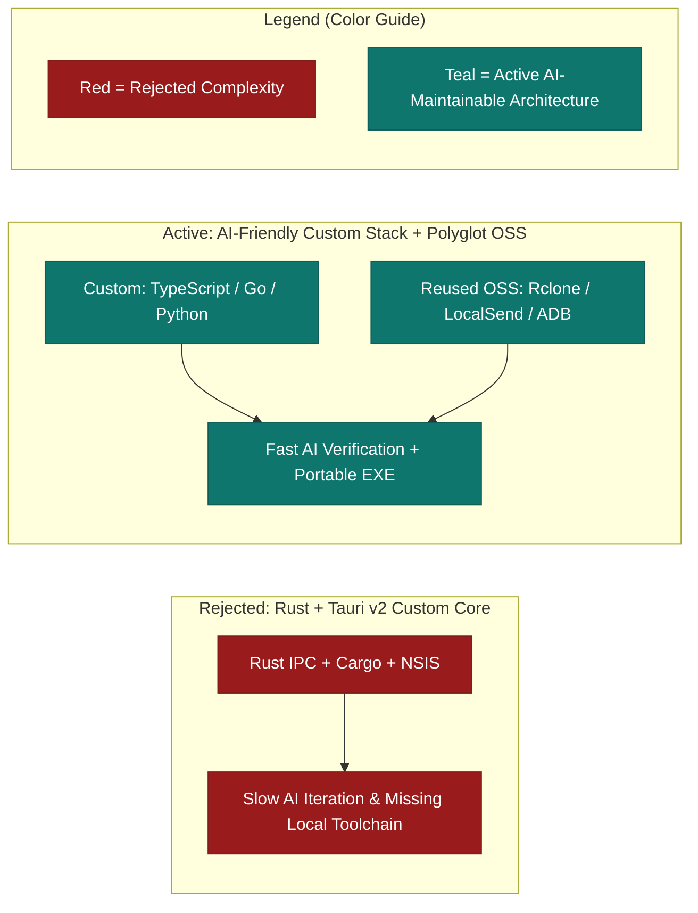
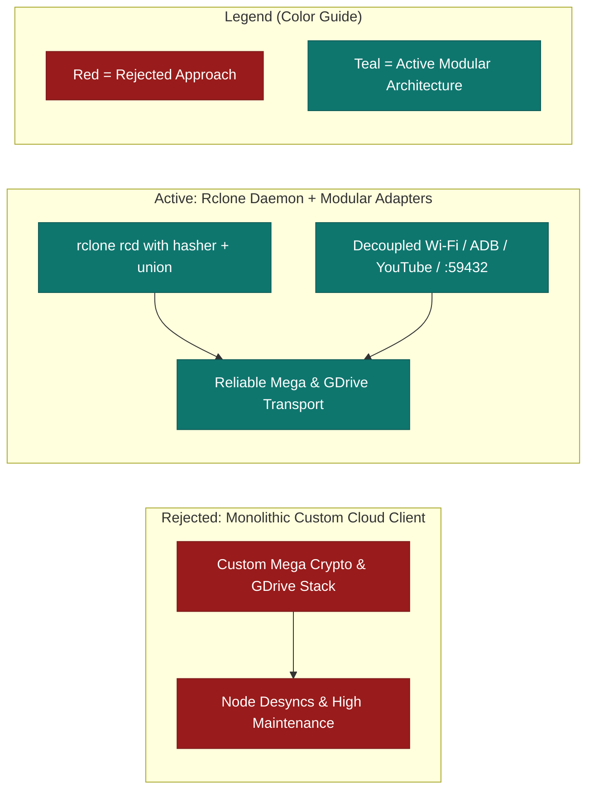
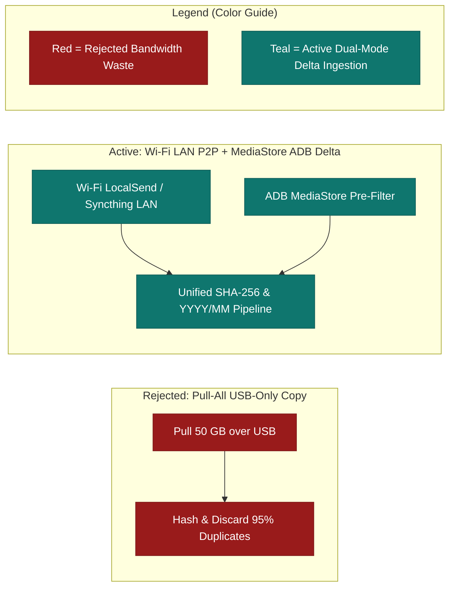

# Architectural Decisions, Pivots & Landmines (`DECISIONS_AND_TRAPS.md`)
> **1-Line Summary:** Records architectural pivots, AI-friendly stack choices, Wi-Fi+ADB sync decisions, and critical runtime landmines for Cloud Manager.

## 1. Architectural Decisions & Pivot History

### [DECISION: AI-Friendly-Custom-Stack-And-Polyglot-OSS-Reuse] | Aliases: ai friendly stack, drop rust tauri, go python typescript
> **1-Line Summary:** Replaced Rust/Tauri v2 with custom code strictly in TypeScript/JS, Go, or Python while allowing battle-tested reused OSS binaries in any language.
* **Decision Maker:** `[DECIDED BY: HUMAN]`
* **Original User Intention:** Build, maintain, and iterate on Cloud Manager rapidly using AI coding agents without heavyweight local toolchains or Rust borrow-checker churn.
* **Options Considered:**
  * **Option A (Rejected):** Tauri v2 (Rust backend + Svelte frontend) with an NSIS installer. Rejected because `rustc`/`cargo` are absent locally, prior Tauri experiments added friction, and AI agents maintain TypeScript/Go/Python faster.
  * **Option B (Chosen):** Custom core + UI in **TypeScript/JS, Go, or Python**, wrapped as a portable Windows `.exe`, while reusing mature external OSS (`Rclone`, `LocalSend v2`, optional `Syncthing` LAN-only, optional `ADB`, `SQLite`) regardless of upstream language.
* **Visual Pivot Map:**

* **Scope:** Planned core daemon & TypeScript frontend.

---

### [DECISION: Hybrid-Rclone-Modular-Assembly] | Aliases: rclone daemon, modular cloud stack, custom vs rclone
> **1-Line Summary:** Adopted Rclone Core (`>= v1.66`) in daemon mode with `union` and `hasher` overlays for Google Drive and Mega while keeping YouTube, Phone Sync, and UI decoupled.
* **Decision Maker:** `[DECIDED BY: HUMAN]`
* **Options Considered:**
  * **Option A (Rejected):** Writing custom Mega.nz crypto and Google Drive APIs from scratch.
  * **Option B (Chosen):** Supervising `rclone rcd` (authenticated ephemeral loopback + DPAPI-encrypted `rclone.conf`) as the cloud transport adapter.
* **Visual Pivot Map:**

* **Scope:** Planned Rclone supervisor module.

---

### [DECISION: Dual-Mode-WiFi-LAN-And-ADB-Phone-Sync] | Aliases: wifi phone sync, adb mediastore filter, lan p2p media
> **1-Line Summary:** Upgraded phone media delta sync to support Same-Router Wi-Fi P2P (`:53317`) alongside pre-filtered ADB MediaStore queries into one SHA-256 pipeline.
* **Decision Maker:** `[DECIDED BY: HUMAN]`
* **Options Considered:**
  * **Option A (Rejected):** Pulling all `/sdcard/DCIM/` files over USB ADB first to deduplicate locally, or requiring USB cables for routine transfers.
  * **Option B (Chosen):** Opt-in Same-Router Wi-Fi P2P (LocalSend v2 HTTPS/TLS + PIN, optional Syncthing LAN-only) **plus** Android MediaStore metadata pre-filtering over ADB (`images/media` + `video/media`), feeding one streaming SHA-256 deduplication pipeline.
* **Visual Pivot Map:**

* **Scope:** Planned Phone Ingestion subsystem.

---

### [DECISION: Hardened-Loopback-Backplane-And-Ecosystem-Contract] | Aliases: port 59432 security, ecosystem contract, csrf guard
> **1-Line Summary:** Secured `:59432` per `ECOSYSTEM_INTEGRATION_CONTRACT.md` v2.0.0 with Bearer auth, `Origin` `403` rejection, `Host` checks, and separate opt-in LAN `:53317`.
* **Decision Maker:** `[DECIDED BY: HUMAN]`
* **Rationale:** Unauthenticated localhost HTTP servers are exposed to browser CSRF and DNS rebinding. Isolating `127.0.0.1:59432` (Bearer auth via `ecosystem-secrets.json`) from opt-in LAN P2P (`53317`, non-colliding with GaussBoard `53318`/`53319`) protects custom `.exe` app databases.
* **Scope:** Planned Localhost Backplane & LAN P2P boundary.

---

### [DECISION: YouTube-As-Dedicated-Video-Archive] | Aliases: youtube private pipeline, video storage routing
> **1-Line Summary:** Routes large screen recordings to YouTube via Data API v3 with enforced `private` visibility and playlist assignment instead of filling cloud drive quotas.
* **Decision Maker:** `[DECIDED BY: HUMAN]`
* **Scope:** Planned YouTube pipeline.

---

### [DECISION: SQLite-WAL-Local-Virtual-Catalog] | Aliases: local file cache, sqlite wal mode, offline file explorer
> **1-Line Summary:** Caches multi-cloud metadata, remote change cursors, tombstones, and job queues in SQLite WAL + FTS5 for sub-5 ms offline browsing.
* **Decision Maker:** `[DECIDED BY: AGENT - Approved by Human]`
* **Scope:** Planned SQLite catalog & migration engine.

---

## 2. Do-Not-Touch Engineering Landmines (`[TRAP]`)

### [TRAP: Mega-Missing-ModTime-And-Remote-Hash] | Aliases: mega bisync loop, mega modtime bug, rclone hasher
> **1-Line Summary:** NEVER run timestamp-based `rclone bisync` on Mega remotes without Rclone `hasher` (`>= v1.66`), because Mega lacks native `ModTime` and standard remote hashes.
* **Strict Rule:** Treat Mega pools as append/archive targets tracked by local SHA-256 + Rclone `hasher` (`--compare size,checksum`), and reserve native `Changes.list` `bisync` for Google Drive.

### [TRAP: Mega-Concurrent-Node-Session-Limits] | Aliases: mega node desync, mega session error, concurrent mega upload
> **1-Line Summary:** NEVER spawn independent raw Mega upload threads outside Rclone's `rcd` pool, or Mega will return node invalidation and session errors.
* **Strict Rule:** Route all Mega transfers exclusively through the single supervised `rclone rcd` process and handle HTTP `509` residential IP bandwidth ceilings with backoff.

### [TRAP: Unauthenticated-Loopback-CSRF-And-Live-SQLite-Copy] | Aliases: port 59432 csrf, dns rebinding, live sqlite corruption
> **1-Line Summary:** NEVER expose `127.0.0.1:59432` without Bearer/`Origin`/`Host` validation, and NEVER copy a live `.sqlite` file without `VACUUM INTO` snapshots.
* **Strict Rule:** Reject requests with browser `Origin` headers (`403`), enforce `ecosystem-secrets.json` tokens, sanitize `?app=` and filenames, and capture live app SQLite DBs via `VACUUM INTO` before syncing.

### [TRAP: Orphaned-Child-Processes-Without-Job-Object] | Aliases: orphan rclone process, windows job object, child cleanup
> **1-Line Summary:** NEVER spawn `rclone rcd` or `adb` on Windows without attaching them to a Windows Job Object (`JOB_OBJECT_LIMIT_KILL_ON_JOB_CLOSE`).
* **Strict Rule:** Bind all daemon child processes to a Job Object and call `core/quit` on clean shutdown so crashes never leave zombie Mega/port locks behind.

### [TRAP: ADB-Windows-CRLF-Double-Newline] | Aliases: adb newline bug, adb windows parse error, adb shell output
> **1-Line Summary:** NEVER parse `adb shell` stdout on Windows without stripping `\r`, and NEVER confuse MediaStore `date_modified` (seconds) with `datetaken` (ms).
* **Strict Rule:** Execute ADB via argv arrays (`shell=False`), query both `images/media` and `video/media` using `relative_path`, sanitize `\r\r\n`, and normalize timestamps to UTC seconds.

### [TRAP: Google-OAuth-Testing-Mode-7-Day-Expiry] | Aliases: oauth testing expiry, 7 day refresh token, youtube oauth
> **1-Line Summary:** NEVER leave the Google Cloud OAuth consent screen in `Testing` mode for production personal use, or refresh tokens will expire every 7 days.
* **Strict Rule:** Document switching the personal OAuth app to `In Production`, request minimal scopes (`youtube.upload` + `youtube.force-ssl` for playlists), and store tokens via Windows DPAPI.

### [TRAP: YouTube-Daily-Quota-Burn] | Aliases: youtube quota 10000, 403 quota exceeded, polling video status
> **1-Line Summary:** NEVER poll `videos.list` after uploads, and NEVER restart failed uploads without persisting the resumable `Location` URI and PT quota ledger.
* **Strict Rule:** Track daily PT usage (1,650 units/video, hard cap `9,600 / 10,000`) and persist resumable `Location` URIs in SQLite.

### [TRAP: SQLite-Multi-Thread-Busy-Timeout] | Aliases: database locked, sqlite busy, ui freeze, progress wal thrash
> **1-Line Summary:** NEVER open SQLite without `WAL` + `PRAGMA busy_timeout = 5000`, and NEVER flush per-chunk progress bars into SQLite on every tick.
* **Strict Rule:** Keep live throughput meters in memory (`<= 5 Hz` SSE to UI), write SQLite only on discrete state transitions, and gate schema changes with `PRAGMA user_version` + `.bak` snapshots.
