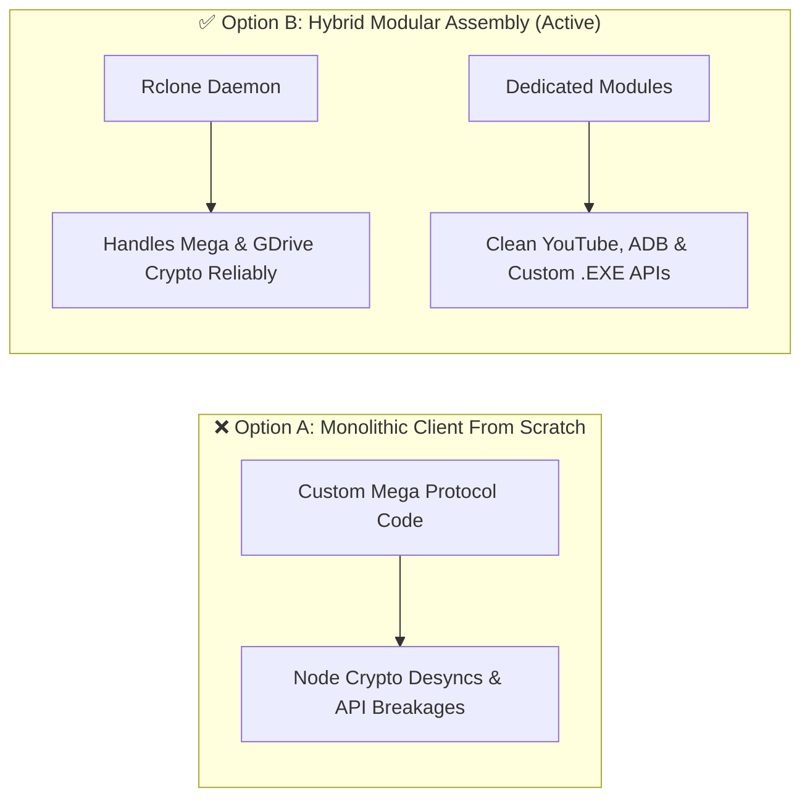

# Architectural Decisions, Pivots & Landmines (`DECISIONS_AND_TRAPS.md`)
> **1-Line Summary:** Records why we chose specific approaches, what failed when we tried other ways, who made the decision, and critical code traps never to touch.

## 1. Architectural Decisions & Pivot History

### [DECISION: Hybrid-Rclone-Modular-Assembly] | Aliases: rclone daemon, modular cloud stack, custom vs rclone
> **1-Line Summary:** Adopted Rclone Core in daemon mode for Google Drive and Mega transport while keeping YouTube, ADB, and UI as decoupled modular subsystems.
* **Decision Maker:** `[DECIDED BY: HUMAN]`
* **Original User Intention:** Centralize multiple Google Drive and Mega accounts into a customizable sync manager without being locked into a rigid monolithic app.
* **Options Considered:**
  * **Option A (Rejected):** Writing a monolithic custom Go/Rust client implementing Mega.nz's proprietary C++ crypto protocol and Google Drive APIs from scratch. Rejected because Mega's client-side node cryptography is complex to maintain and easily breaks on API changes.
  * **Option B (Chosen):** Hybrid best-of-breed assembly: Rclone handles low-level cloud protocols and cryptographic handshakes; a lightweight Tauri desktop app orchestrates the rule engine, ADB phone transfers, and YouTube uploads.
* **Visual Pivot Map (What Failed vs. What Works):**



* **Code Anchors (Grep Targets):**
  * `src-tauri/src/rclone/supervisor.rs` -> `RcloneDaemonSupervisor::start`

---

### [DECISION: ADB-MediaStore-Metadata-Pre-Filter] | Aliases: phone sync filter, adb metadata check, avoid full transfer
> **1-Line Summary:** Pre-filters phone photos directly on Android using MediaStore metadata to transfer only genuinely new media over ADB.
* **Decision Maker:** `[DECIDED BY: HUMAN]`
* **Original User Intention:** An easy, optimal way to know which photos/videos on the phone are already synced to PC and avoid re-copying existing files during periodic connections.
* **Options Considered:**
  * **Option A (Rejected):** Pulling all files from `/sdcard/DCIM/Camera/` to a temporary directory on the PC and checking SHA-256 hashes locally. Rejected because transferring 40+ GB over USB/WiFi just to discard duplicates wastes massive bandwidth and takes hours.
  * **Option B (Chosen):** Running a fast metadata query on the phone via `adb shell content query` (matching file size and modification timestamps against the local SQLite database). Only missing files are transferred via `adb pull`.
* **Visual Pivot Map (What Failed vs. What Works):**

```mermaid
flowchart LR
    subgraph Failed["❌ Option A: Pull Everything Then Filter"]
        A1[Pull 50GB over ADB] --> A2[Compute Hashes Locally] --> A3[Discard 95% of duplicates (Very Slow)]
    end
    subgraph Active["✅ Option B: Phone-Side Metadata Query"]
        B1[Query Phone MediaStore in 100ms] --> B2[Compare with SQLite Catalog] --> B3[Pull ONLY New Files (Blazing Fast)]
    end
```

* **Code Anchors (Grep Targets):**
  * `src-tauri/src/adb/client.rs` -> `AdbDeviceManager::query_mediastore`
  * `src-tauri/src/adb/sync_worker.rs` -> `filter_unsynced_items`

---

### [DECISION: YouTube-As-Dedicated-Video-Archive] | Aliases: youtube private pipeline, video storage routing, bypass cloud storage
> **1-Line Summary:** Routed video recordings to YouTube via Data API v3 with private visibility and playlist targeting instead of filling Google Drive or Mega quotas.
* **Decision Maker:** `[DECIDED BY: HUMAN]`
* **Original User Intention:** Automatically upload screen recordings and project videos with pre-designated private settings and playlist assignment.
* **Options Considered:**
  * **Option A (Rejected):** Storing video recordings directly in Google Drive or Mega accounts. Rejected because high-bitrate screen recordings rapidly exhaust the 15 GB Google Drive and 20 GB Mega free limits, and cannot be streamed conveniently across devices.
  * **Option B (Chosen):** Uploading to YouTube with enforced `privacyStatus: private` and automatic assignment to specific playlist IDs.
* **Code Anchors (Grep Targets):**
  * `src-tauri/src/youtube/uploader.rs` -> `YouTubeUploader::upload_resumable_video`

---

### [DECISION: SQLite-WAL-Local-Virtual-Catalog] | Aliases: local file cache, sqlite wal mode, offline file explorer
> **1-Line Summary:** Caches all multi-cloud file metadata in a local SQLite database in WAL mode to provide sub-millisecond explorer browsing without network latency.
* **Decision Maker:** `[DECIDED BY: AGENT - Approved by Human]`
* **Original User Intention:** High-speed, responsive file explorer that lazy-loads files without stuttering.
* **Options Considered:**
  * **Option A (Rejected):** Querying Google Drive and Mega APIs live whenever the user browses a folder. Rejected because cloud API rate limits, latency, and pagination cause noticeable UI lag.
  * **Option B (Chosen):** Local SQLite catalog with Write-Ahead Logging (WAL) and FTS5 search. Cloud sync happens in the background, updating the SQLite state asynchronously.
* **Code Anchors (Grep Targets):**
  * `src-tauri/src/db/catalog.rs` -> `DatabaseManager::initialize_schema`

---

## 2. Do-Not-Touch Engineering Landmines (Traps)

### [TRAP: Mega-Concurrent-Node-Session-Limits] | Aliases: mega node desync, mega session error, concurrent mega upload
> **1-Line Summary:** NEVER spawn independent raw Mega upload threads outside of Rclone's connection pool, or Mega will return node invalidation errors.
* **Strict Rule:** **NEVER** bypass Rclone to issue simultaneous raw HTTP uploads to the same Mega account.
* **Why This Trap Exists (Plain English):** Mega.nz maintains a strictly synchronized client-side node tree. When multiple uncoordinated processes write to the same account at once, node sequence numbers diverge, causing Mega's API to reject subsequent uploads with session expiration and node-not-found errors.
* **Protected Code Anchors (Grep Targets):**
  * `src-tauri/src/rclone/supervisor.rs` -> `RcloneDaemonSupervisor::get_upload_queue`

---

### [TRAP: ADB-Windows-CRLF-Double-Newline] | Aliases: adb newline bug, adb windows parse error, adb shell output
> **1-Line Summary:** NEVER parse raw string output from `adb shell` on Windows without trimming carriage returns (`\r\r\n`), or file size parsing will fail.
* **Strict Rule:** **NEVER** directly parse integer bytes from `adb shell` standard output without running a regex sanitization for `\r`.
* **Why This Trap Exists (Plain English):** Windows converts standard UNIX line feeds into CRLF. When `adb.exe` runs an Android shell command, the Android pty adds `\r\n`, and the Windows console runtime adds an additional `\r`, resulting in `\r\r\n`. Parsing `123456\r\r\n` directly as a 64-bit integer throws a `ParseIntError`.
* **Protected Code Anchors (Grep Targets):**
  * `src-tauri/src/adb/client.rs` -> `sanitize_adb_output`

---

### [TRAP: YouTube-Daily-Quota-Burn] | Aliases: youtube quota 10000, 403 quota exceeded, polling video status
> **1-Line Summary:** NEVER poll the YouTube Data API to check video processing status in a fast loop; uploads cost 1,600 units out of the 10,000 daily limit.
* **Strict Rule:** **NEVER** poll `videos.list` or `videos.insert` repeatedly after an upload completes.
* **Why This Trap Exists (Plain English):** Google assigns a default ceiling of 10,000 quota units per day per project. A single video insert uses 1,600 units (allowing ~6 uploads per day). Repeated polling burns the remaining units within seconds, returning `403 QuotaExceeded` for all users until midnight Pacific Time.
* **Protected Code Anchors (Grep Targets):**
  * `src-tauri/src/youtube/uploader.rs` -> `handle_resumable_completion`

---

### [TRAP: SQLite-Multi-Thread-Busy-Timeout] | Aliases: database locked, sqlite busy, ui freeze
> **1-Line Summary:** NEVER open an SQLite connection in the desktop app without setting `PRAGMA busy_timeout = 5000;` and enabling WAL mode.
* **Strict Rule:** **NEVER** execute write queries from background sync threads without a 5-second busy timeout.
* **Why This Trap Exists (Plain English):** The background sync daemon continuously records upload progress and delta events while the desktop GUI reads from the catalog for 60 FPS scrolling. Without WAL mode and busy timeout, concurrent writes throw `database is locked` (`SQLITE_BUSY`), crashing or freezing the UI.
* **Protected Code Anchors (Grep Targets):**
  * `src-tauri/src/db/connection.rs` -> `create_sqlite_connection`
