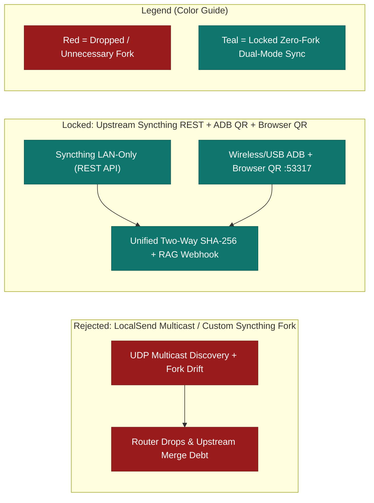

# Architectural Decisions, Pivots & Landmines (`DECISIONS_AND_TRAPS.md`)
> **1-Line Summary:** Records locked stack pivots (`Go + TypeScript`), upstream Syncthing REST control, Wi-Fi+ADB phone sync, and critical runtime landmines.

## 1. Architectural Decisions & Pivot History

### [DECISION: AI-Friendly-Custom-Stack-And-Polyglot-OSS-Reuse] | Aliases: ai friendly stack, go typescript locked, drop rust tauri
> **1-Line Summary:** Locked **Go (`Alpha 1`) + TypeScript Local Browser UI + System Tray (`Alpha 4`)** for all custom code while reusing polyglot OSS binaries externally.
* **Decision Maker:** `[DECIDED BY: HUMAN]`
* **Options Considered:**
  * **Option A (Rejected):** Rust + Tauri v2 with NSIS installer (missing local toolchain, heavy AI iteration overhead).
  * **Option B (Deferred Post-v1):** Portable Electron `.exe` shell (UI stays cleanly decoupled so Electron can wrap it later with zero backend rewrite).
  * **Option C (Locked):** **Go** core daemon (`cloud-managerd.exe` + `cloud-manager.exe --json`, ~15 MB static `.exe`, ~25 MB idle RAM) + **TypeScript** browser UI + System Tray, built and verified in GitHub Actions CI.
* **Visual Pivot Map:**

* **Scope:** `[PLANNED]` Go core daemon, CLI, and TypeScript UI.

---

### [DECISION: Dual-Mode-WiFi-LAN-And-ADB-Phone-Sync] | Aliases: syncthing upstream vs fork, wireless adb, browser qr, rag webhook
> **1-Line Summary:** Locked **unmodified upstream Syncthing (LAN-Only REST API)** + **Wireless/USB ADB (QR pair)** + **Browser QR Drop-Zone** + **`RAG Manager :27130` webhook**, dropping LocalSend.
* **Decision Maker:** `[DECIDED BY: HUMAN]`
* **Rationale:** LocalSend relies on UDP multicast (blocked across many router bands/firewalls) and lacks two-way folder delta inspection. Supervising **unmodified upstream Syncthing** over its local REST API & Event Stream gives QR pairing, pause/resume click-to-sync, LAN-only mode, and block-level deltas for `Obsidian`, `GaussBoard`, `Music`, `DCIM`, `PDFs`, and `Markdown` with **zero fork maintenance burden**. Wireless/USB ADB QR pairing adds zero-app folder diffing, `:53317` Browser QR Drop-Zone covers ad-hoc transfers, and `Obsidian`/`GaussBoard` changes trigger `RAG Manager :27130`.
* **Visual Pivot Map:**

* **Scope:** `[PLANNED]` Phone Ingestion & RAG Webhook subsystem.

---

### [DECISION: Hybrid-Rclone-Modular-Assembly] | Aliases: rclone daemon, modular cloud stack, custom vs rclone
> **1-Line Summary:** Adopted Rclone Core (`>= v1.66`) in daemon mode (`rcd`) for Google Drive and Mega transport while keeping YouTube, Phone Sync, Kopia, and UI decoupled.
* **Decision Maker:** `[DECIDED BY: HUMAN]`
* **Scope:** `[PLANNED]` Rclone supervisor module.

---

### [DECISION: Locked-Pool-YouTube-Kopia-And-UI-Design] | Aliases: charlie 1 charlie 3, delta 1-6, echo 1, kopia bridge, material 3
> **1-Line Summary:** Locked Mega Append/Archive (`Charlie 1`), custom Go YouTube SDK (`Charlie 3`), full Pentagram/Kopia/Lateral suite (`Delta 1-6`), and Material 3 UI (`Echo 1, 3-5`).
* **Decision Maker:** `[DECIDED BY: HUMAN]`
* **Locked Choices:**
  * **Pool & Video:** Rclone `union` + `hasher` treating Mega as Append/Archive and Google Drive for `bisync` (`Charlie 1`); ~200 LOC Go YouTube v3 uploader with SQLite resumable URIs and `9,600` PT quota cap (`Charlie 3`).
  * **Automation & Ecosystem (`Delta 1–6`):** Rule Dry-Run Simulator, Quota Spillover & Bandwidth Scheduler, Cross-Account Duplicate Inspector, headless `--json` CLI + `/mcp` + `cloud-manager://` URI, dual `ecosystem-registry.json` + `ecosystem-secrets.json` registration, and Kopia FastCDC block-delta snapshots for large `.exe` app directories.
  * **UI/UX (`Echo 1, 3, 4, 5`):** Clean Minimalist + Material 3 Tonal Surfaces (`Light`/`Dark`/`System` WCAG AA), `Ctrl+K` quick-picker + `?` shortcut sheet, `Comfortable`/`Compact` density toggle, and `Space` Quick-Look preview.

---

### [DECISION: Hardened-Loopback-Backplane-And-Ecosystem-Contract] | Aliases: port 59432 security, ecosystem contract, csrf guard
> **1-Line Summary:** Enforced `ECOSYSTEM_INTEGRATION_CONTRACT.md` v2.0.0 on `127.0.0.1:59432` (Bearer/`Origin`/`Host`/path jail) and isolated opt-in LAN QR `:53317`.
* **Decision Maker:** `[DECIDED BY: HUMAN]`
* **Scope:** `[PLANNED]` Loopback Backplane & LAN P2P boundary.

---

### [DECISION: SQLite-WAL-Local-Virtual-Catalog] | Aliases: local file cache, sqlite wal mode, offline file explorer
> **1-Line Summary:** Caches multi-cloud metadata, remote change cursors, tombstones, and job queues in SQLite WAL + FTS5 for sub-5 ms offline browsing.
* **Decision Maker:** `[DECIDED BY: AGENT - Approved by Human]`
* **Scope:** `[PLANNED]` SQLite catalog & migration engine.

---

## 2. Do-Not-Touch Engineering Landmines (`[TRAP]`)

### [TRAP: Mega-Missing-ModTime-And-Remote-Hash] | Aliases: mega bisync loop, mega modtime bug, rclone hasher
> **1-Line Summary:** NEVER run timestamp-based `rclone bisync` on Mega remotes without Rclone `hasher` (`>= v1.66`), because Mega lacks native `ModTime` and standard remote hashes.
* **Strict Rule:** Keep Mega pools in Append/Archive mode tracked by local SHA-256 + Rclone `hasher`, and reserve `bisync` (`Changes.list`) for Google Drive.

### [TRAP: Mega-Concurrent-Node-Session-Limits] | Aliases: mega node desync, mega session error, concurrent mega upload
> **1-Line Summary:** NEVER spawn independent raw Mega upload threads outside Rclone's `rcd` pool, or Mega will return node invalidation and session errors.
* **Strict Rule:** Route all Mega transfers exclusively through the supervised `rclone rcd` daemon and handle HTTP `509` per-IP limits with backoff.

### [TRAP: Unauthenticated-Loopback-CSRF-And-Live-SQLite-Copy] | Aliases: port 59432 csrf, dns rebinding, live sqlite corruption
> **1-Line Summary:** NEVER expose `127.0.0.1:59432` without Bearer/`Origin`/`Host` checks, and NEVER copy a live `.sqlite` file without `VACUUM INTO` snapshots.
* **Strict Rule:** Reject browser `Origin` headers (`403`), enforce `ecosystem-secrets.json` tokens, sanitize `?app=` and filenames, and snapshot live DBs via `VACUUM INTO`.

### [TRAP: Orphaned-Child-Processes-Without-Job-Object] | Aliases: orphan rclone process, windows job object, child cleanup
> **1-Line Summary:** NEVER spawn `rclone rcd`, `syncthing`, `adb`, or `kopia` on Windows without attaching them to a Windows Job Object (`JOB_OBJECT_LIMIT_KILL_ON_JOB_CLOSE`).
* **Strict Rule:** Bind all child processes to a Job Object and trigger graceful shutdown (`core/quit` / `/rest/system/shutdown`) on exit.

### [TRAP: ADB-Windows-CRLF-Double-Newline] | Aliases: adb newline bug, adb windows parse error, adb shell output
> **1-Line Summary:** NEVER parse `adb shell` stdout on Windows without stripping `\r`, and NEVER confuse MediaStore `date_modified` (seconds) with `datetaken` (ms).
* **Strict Rule:** Execute ADB via Go argv arrays (`exec.Command`), query both `images/media` and `video/media` with `relative_path`, sanitize `\r\r\n`, and normalize timestamps to UTC seconds.

### [TRAP: Google-OAuth-Testing-Mode-7-Day-Expiry] | Aliases: oauth testing expiry, 7 day refresh token, youtube oauth
> **1-Line Summary:** NEVER leave the Google Cloud OAuth consent screen in `Testing` mode for production personal use, or refresh tokens will expire every 7 days.
* **Strict Rule:** Set personal OAuth consent to `In Production`, request minimal scopes (`youtube.upload` + `youtube.force-ssl`), and protect tokens via Windows DPAPI.

### [TRAP: YouTube-Daily-Quota-Burn] | Aliases: youtube quota 10000, 403 quota exceeded, polling video status
> **1-Line Summary:** NEVER poll `videos.list` after uploads, and NEVER restart failed uploads without persisting the resumable `Location` URI and PT quota ledger.
* **Strict Rule:** Track daily PT quota (1,650 units/video, cap `9,600 / 10,000`) and persist resumable `Location` URIs in SQLite.

### [TRAP: SQLite-Multi-Thread-Busy-Timeout] | Aliases: database locked, sqlite busy, ui freeze, progress wal thrash
> **1-Line Summary:** NEVER open SQLite without `WAL` + `PRAGMA busy_timeout = 5000`, and NEVER flush per-chunk progress bars into SQLite on every tick.
* **Strict Rule:** Stream live metrics from memory (`<= 5 Hz` SSE), persist only discrete job state transitions, and guard schema changes with `PRAGMA user_version` + `.bak` snapshots.
