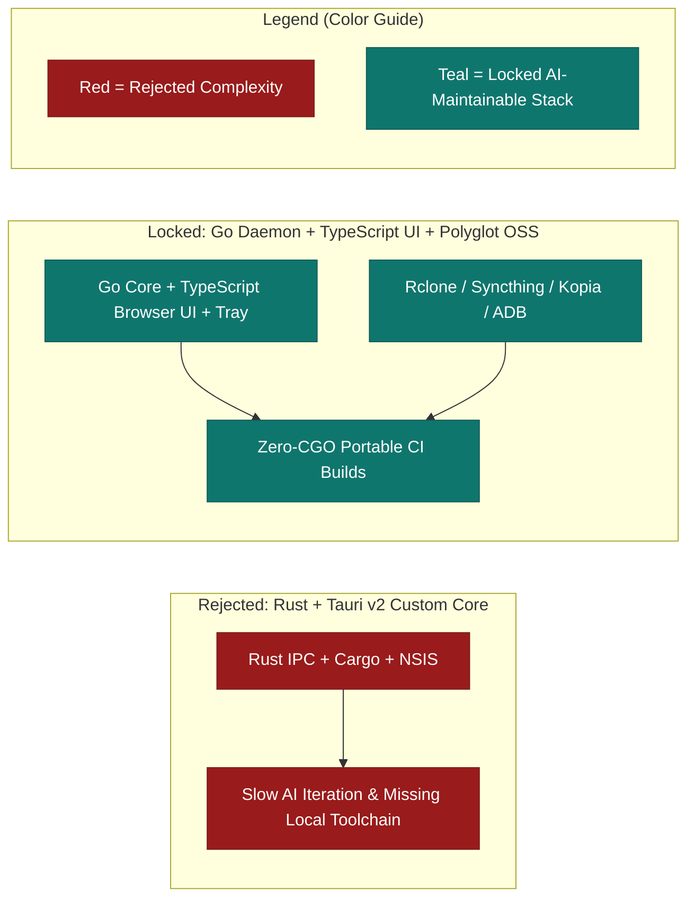

# Architectural Decisions, Pivots & Landmines (`DECISIONS_AND_TRAPS.md`)
> **1-Line Summary:** Records locked stack pivots (`Go + TypeScript`), zero-CGO SQLite & nonce-guarded CSP choices, upstream Syncthing REST control, and critical runtime landmines.

## 1. Architectural Decisions & Pivot History

### [DECISION: AI-Friendly-Custom-Stack-And-Polyglot-OSS-Reuse] | Aliases: ai friendly stack, go typescript locked, drop rust tauri
> **1-Line Summary:** Locked **Go + TypeScript Local Browser UI + System Tray** for all custom code while reusing polyglot OSS binaries externally.
* **Decision Maker:** `[DECIDED BY: HUMAN]`
* **Options Considered:**
  * **Option A (Rejected):** Rust + Tauri v2 with NSIS installer (missing local toolchain, heavy AI iteration overhead).
  * **Option B (Deferred Post-v1):** Portable Electron `.exe` shell (UI stays cleanly decoupled so Electron can wrap it later with zero backend rewrite).
  * **Option C (Locked & Implemented):** **Go** core daemon (`cmd/cloud-managerd`, `cmd/cloud-manager`, unified `cmd/CloudManager`) + **TypeScript** browser UI (`web/`) + Win32 System Tray (`internal/tray`), cross-compiled cleanly on GitHub Actions CI.
* **Visual Pivot Map:**

* **Scope:** `[IMPLEMENTED]` `cmd/`, `internal/`, and `web/`.

---

### [DECISION: Pure-Go-SQLite-And-Zero-CGO-Win32-Tray] | Aliases: modernc sqlite, zero cgo, pure go systray, cross compile windows
> **1-Line Summary:** Selected `modernc.org/sqlite` and pure-Go `x/sys/windows` Win32/Job-Object/DPAPI syscalls (`CGO_ENABLED=0`) so Ubuntu CI cross-compiles Windows `.exe`s cleanly and runs `-race` tests without C toolchains.
* **Decision Maker:** `[DECIDED BY: AGENT - Implemented]`
* **Rationale:** Standard `mattn/go-sqlite3` and CGO systray libraries require MinGW/GCC/GTK headers on Linux runners and slow cross-compilation. Isolating Windows Job Objects (`internal/security/job_windows.go`), DPAPI (`internal/security/dpapi_windows.go`), and Win32 NotifyIcon (`internal/tray/tray_windows.go`) behind `//go:build windows` tags paired with `modernc.org/sqlite` enables `CGO_ENABLED=0 GOOS=windows GOARCH=amd64` cross-builds on Ubuntu plus native verification on `windows-latest`.

---

### [DECISION: Dual-Mode-WiFi-LAN-And-ADB-Phone-Sync] | Aliases: syncthing upstream vs fork, wireless adb, browser qr, rag webhook
> **1-Line Summary:** Locked **unmodified upstream Syncthing (LAN-Only REST API)** + **Wireless/USB ADB (QR pair)** + **Browser QR Drop-Zone** + **`RAG Manager :27130` webhook**, dropping LocalSend.
* **Decision Maker:** `[DECIDED BY: HUMAN]`
* **Rationale:** LocalSend relies on UDP multicast and lacks two-way folder delta inspection. Supervising unmodified upstream Syncthing (`internal/adapters/syncthing`) over its local REST API gives QR pairing, pause/resume click-to-sync, LAN-only mode, and block-level deltas for `Obsidian`, `GaussBoard`, `Music`, `DCIM`, `PDFs`, and `Markdown`. Wireless/USB ADB QR pairing (`internal/adapters/adb`) adds zero-app folder diffing, `:53317` Browser QR Drop-Zone (`internal/adapters/lanqr`) covers ad-hoc transfers, and `Obsidian`/`GaussBoard` changes trigger `RAG Manager :27130` (`internal/ingest`).

---

### [DECISION: Nonce-Guarded-FOUC-Theme-Under-Strict-CSP] | Aliases: csp nonce, fouc prevention, color scheme meta, material 3
> **1-Line Summary:** Injected a per-request CSP nonce onto the inline FOUC-prevention script (`<script data-cm-fouc>`) in `Daemon.serveIndexWithSession` alongside `<meta name="cm-session">`.
* **Decision Maker:** `[DECIDED BY: AGENT - Implemented]`
* **Rationale:** Pre-paint `<meta name="color-scheme">` restoration must run synchronously before first paint to prevent theme flashes, while strict CSP forbids `'unsafe-inline'` scripts. Rewriting `<script data-cm-fouc>` with a fresh CSPRNG `nonce` on `GET /` satisfies both strict CSP and zero-FOUC Light/Dark/System rendering.

---

### [DECISION: Hybrid-Rclone-And-YouTube-Kopia-UI-Lock] | Aliases: rclone daemon, charlie 1 charlie 3, delta 1-6, echo 1, kopia bridge, material 3
> **1-Line Summary:** Implemented Rclone `hasher` Mega Append/Archive, Go YouTube v3 private resumable uploader, Pentagram CLI/MCP/Kopia contracts, and Material 3 WCAG AA TypeScript UI.
* **Decision Maker:** `[DECIDED BY: HUMAN]`
* **Scope:** `[IMPLEMENTED]` Across `internal/adapters/rclone`, `internal/adapters/youtube`, `internal/adapters/kopia`, `internal/cli`, `internal/server`, and `web/`.

---

## 2. Do-Not-Touch Engineering Landmines (`[TRAP]`)

### [TRAP: Mega-Missing-ModTime-And-Remote-Hash] | Aliases: mega bisync loop, mega modtime bug, rclone hasher
> **1-Line Summary:** NEVER run timestamp-based `rclone bisync` on Mega remotes without Rclone `hasher` (`>= v1.66`), because Mega lacks native `ModTime` and standard remote hashes.
* **Strict Rule:** Keep Mega pools in Append/Archive mode (`rclone.ValidateSyncMode` rejects `bisync` on Mega) tracked by local SHA-256 + Rclone `hasher`, and reserve `bisync` (`Changes.list`) for Google Drive.

### [TRAP: Mega-Concurrent-Node-Session-Limits] | Aliases: mega node desync, mega session error, concurrent mega upload
> **1-Line Summary:** NEVER spawn independent raw Mega upload threads outside Rclone's `rcd` pool, or Mega will return node invalidation and session errors.
* **Strict Rule:** Route all Mega transfers exclusively through the supervised `rclone rcd` daemon (`internal/adapters/rclone`) and handle HTTP `509` per-IP limits with circuit breaker + account cooldown.

### [TRAP: Unauthenticated-Loopback-CSRF-And-Live-SQLite-Copy] | Aliases: port 59432 csrf, dns rebinding, live sqlite corruption
> **1-Line Summary:** NEVER expose `127.0.0.1:59432` without Bearer/`Origin`/`Host` checks, and NEVER copy a live `.sqlite` file without `VACUUM INTO` snapshots.
* **Strict Rule:** Enforce `Daemon.withGuard` (`Origin` `403`, strict `Host`, constant-time Bearer token), sanitize `?app=` and relative paths (`security.ResolveConfinedPath`), and snapshot live DBs via `db.SnapshotSQLiteFile` (`VACUUM INTO`).

### [TRAP: Orphaned-Child-Processes-Without-Job-Object] | Aliases: orphan rclone process, windows job object, child cleanup
> **1-Line Summary:** NEVER spawn `rclone rcd`, `syncthing`, `adb`, or `kopia` on Windows without attaching them to a Windows Job Object (`JOB_OBJECT_LIMIT_KILL_ON_JOB_CLOSE`).
* **Strict Rule:** Bind all child processes via `security.JobSupervisor.AssignPID` and trigger graceful shutdown RPCs on daemon exit.

### [TRAP: ADB-Windows-CRLF-Double-Newline] | Aliases: adb newline bug, adb windows parse error, adb shell output
> **1-Line Summary:** NEVER parse `adb shell` stdout on Windows without stripping `\r`, and NEVER confuse MediaStore `date_modified` (seconds) with `datetaken` (ms).
* **Strict Rule:** Execute ADB via Go argv arrays (`exec.Command`), query both `images/media` and `video/media` with `relative_path`, sanitize `\r\r\n` (`adb.SanitizeOutput`), and normalize timestamps to UTC seconds (`adb.ParseMediaStoreOutput`).

### [TRAP: Google-OAuth-Testing-Mode-7-Day-Expiry] | Aliases: oauth testing expiry, 7 day refresh token, youtube oauth
> **1-Line Summary:** NEVER leave the Google Cloud OAuth consent screen in `Testing` mode for production personal use, or refresh tokens will expire every 7 days.
* **Strict Rule:** Set personal OAuth consent to `In Production`, request minimal scopes (`youtube.upload` + `youtube.force-ssl`), and protect tokens via Windows DPAPI (`security.ProtectSecret`).

### [TRAP: YouTube-Daily-Quota-Burn] | Aliases: youtube quota 10000, 403 quota exceeded, polling video status
> **1-Line Summary:** NEVER poll `videos.list` after uploads, and NEVER restart failed uploads without persisting the resumable `Location` URI and PT quota ledger.
* **Strict Rule:** Track daily PT quota (`1,650` units/video, cap `9,600 / 10,000` via `Store.AddYouTubeQuota`) and persist resumable `Location` URIs in SQLite (`Uploader.ProcessJob`).

### [TRAP: SQLite-Multi-Thread-Busy-Timeout] | Aliases: database locked, sqlite busy, ui freeze, progress wal thrash
> **1-Line Summary:** NEVER open SQLite without `WAL` + `PRAGMA busy_timeout = 5000`, and NEVER flush per-chunk progress bars into SQLite on every tick.
* **Strict Rule:** Stream live metrics from memory (`<= 5 Hz` SSE via `telemetry.Hub`), persist only discrete job state transitions, and guard schema changes with `PRAGMA user_version` + rolling `.bak` snapshots (`db.Open`).

### [DECISION: Windowless-Tray-Auto-Start-And-Per-User-Inno-Installer] | Aliases: windowsgui, inno setup, background autostart, single instance, self upgrade
> **1-Line Summary:** Built `CloudManager.exe` with `-H=windowsgui` + `--background`, single-instance browser wake, demand-driven `0%` idle telemetry, `cloud-manager quit`/`upgrade`, and a zero-admin per-user Inno Setup installer (`CloudManager-Setup.exe`).
* **Decision Maker:** `[DECIDED BY: HUMAN]`
* **Rationale:** Regular background usage requires zero-console startup at Windows sign-in, Desktop/Start Menu shortcuts without UAC elevation, near-zero idle CPU when no UI tab is viewing `:59432`, and effortless 1-command self-upgrades (`cloud-manager upgrade`) or installer updates.

### [TRAP: Windows-Running-Exe-Lock-During-Upgrade] | Aliases: locked exe upgrade, inno setup restart, self update swap
> **1-Line Summary:** NEVER overwrite a running Windows `.exe` in place during an upgrade or uninstall—Windows blocks direct writes on mapped binaries even without an open console window.
* **Strict Rule:** Gracefully stop the background daemon via `POST /api/v1/shutdown` / `cloud-manager quit` before Inno Setup replacement (`PrepareToInstall`/`CurUninstallStepChanged`), and perform safe NTFS `.old` rename-swap + `--background` relaunch inside `cli.runUpgrade`.
